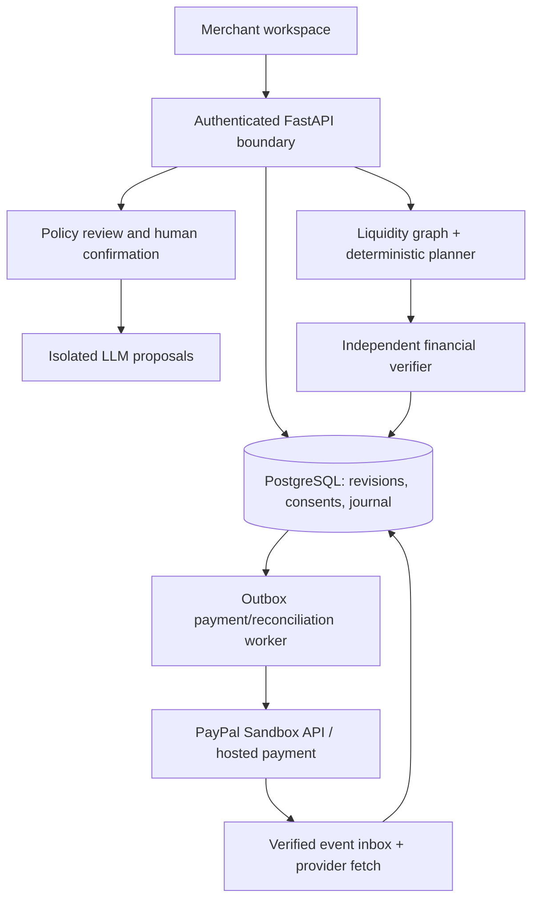

# 08 — System Architecture, Workflows, Reliability

## Architecture decision
Build a **modular monolith**, not premature microservices. Suggested stack: React + TypeScript web interface; Python/FastAPI backend; PostgreSQL for tenant data, immutable plan revisions, approvals and journal; worker with transactional outbox; small exact solver and optionally OR-Tools CP-SAT; separately permissioned PayPal adapter; model adapter isolated from payment tools.



## Domain boundaries
- **Identity & tenants:** merchant user, role, object-level authorization. A buyer cannot inspect its supplier's private reserve/invoice data.
- **Invoice domain:** immutable obligation revisions with source provenance, invoice state and disputed status.
- **Policy and offer domain:** source text, typed constraints, consented terms, expiry/version/digest.
- **Liquidity domain:** time-indexed usable balances, protected reserves, provider evidence or clearly labeled attestation.
- **Planner:** candidate plans and independent replay verifier; pure deterministic code with no network access.
- **Execution:** session creation and authenticated payer action, idempotent intent/outbox and verified outcome.
- **Reconciliation:** external provider truth mapped to local finance journal and exceptional states.
- **AI:** typed proposals, model observability and manual fallback; no direct payment permissions.

## Plans and legs
Plan states: `draft → verified → awaiting_consent → executable → running → reconciled`; terminal or exceptional `declined`, `expired`, `superseded`, `blocked`, `exception`. A leg goes `proposed → approved → payer_action_required → provider_pending → provider_confirmed → funds_usable_attested`. A paid leg remains historically paid even if a later reversal posts a separate exception; do not revert history by mutation.

## Saga pattern (partial failure)
A→B succeeds, but B→C cannot proceed. Elide cannot reverse A automatically. Persist A's verified receipt and postings, mark B→C blocked, release unused reservations, surface residual open invoices, and offer a **new** approved plan. This is an asynchronous saga with human-gated payments, not a database transaction spanning independent PayPal accounts.

## Concurrency and idempotency
Lock relevant invoice/revision and capacity rows in deterministic order inside one DB transaction. Reject stale approval digest. Reserve active plan cash once. Commit payment intent and outbox row atomically. Worker retries with endpoint-supported idempotency where documented; if response is unknown, fetch provider state before considering new action. Webhooks may duplicate or arrive out-of-order; deduplicate provider event IDs, confirm signatures, fetch authoritative state and prevent state regressions. Never hold database locks during network requests.

## Ledger and money correctness
Keep an append-only journal (per currency) with balanced postings for cash receipts, provider fees, concessions, available/held reclassifications and subsequent reversals. Provider-visible payment status is distinct from a merchant's current deployable capacity attestation. Plan projections do not mutate financial accounts.

## Development layout
```text
web/
api/app/                    # FastAPI endpoints
api/domain/                 # immutable money, invoice, offers, policies
api/planning/               # exact reference search, optimization, replay
api/ai/                     # adapter + schema validation
api/integrations/paypal/    # merchant-owned provider adapter
api/workers/                # durable intents, event reconciliation
migrations/
fixtures/
tests/unit/ tests/property/ tests/contract/ tests/sandbox/
evidence/                   # redacted actual receipts, manifests
```

## Operational diagnostics
Track plan feasibility ratio, solver status/time, stale approvals, rejected policies, unknown payments, webhook age, unmatched provider resources, duplicate posting prevention, reserve violation attempts, audit exceptions and tenant-isolation failures. Provide kill switch for new payments without preventing reconciliation or read access.

## Deployment posture
One backend deployment + PostgreSQL is enough for the hackathon. Preserve ability to run independent solver tests offline. Public repo must contain a runnable synthetic demonstration without private credentials, and separately document how to supply own Sandbox credentials for live payment steps.
